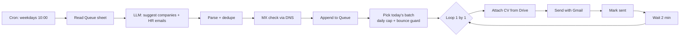

# Job Application Automation (n8n)

An n8n workflow that finds small and mid-size tech companies, validates their domains, and sends personalised job-application emails on a schedule — with built-in safety rails (MX validation, daily cap, bounce tracking and an automatic stop).

> **Status:** working prototype. Built as a learning/portfolio project; see [Limitations](#limitations-and-lessons-learned) for an honest account of what works and what doesn't.

## How it works

A second workflow runs every weekday morning, reads Gmail for delivery-failure notices (`mailer-daemon`), and marks those addresses as `bounced` so they are never mailed again and the guard can react.

| Workflow | File | Purpose |
|---|---|---|
| Daily application | `workflows/01-daily-application.json` | Discover → validate → send (one mail every 2 min) |
| Bounce tracker | `workflows/02-bounce-tracker.json` | Detect failed deliveries, mark rows `bounced` |
| Website email scraper (experimental) | `workflows/experimental/website-email-scraper.json` | Reads companies' public contact pages for HR addresses |

## Safety features
- **MX validation:** guessed addresses are dropped when the domain has no mail server (Google DNS-over-HTTPS).
- **De-duplication:** one email per company/domain, never re-mailing known addresses.
- **Daily cap:** default 5 per day (`DAILY_CAP`), meant to be raised slowly.
- **Bounce guard:** the run stops with an error if more than 30 % of mails bounced (after 6 results).
- **Time window:** weekdays only, local time (`Europe/Istanbul`).
- **No secrets in the repo:** API keys live in n8n credentials.

## Stack
n8n (self-hosted, Community Edition) · Groq API (`openai/gpt-oss-120b`) · Google Sheets / Drive / Gmail · Google public DNS API

## Setup
1. Run n8n (`npx n8n` for a quick start, or `docker compose up -d` — see `docker-compose.yml`).
2. Create a Google Sheet with a tab named **`Queue`** and the headers in `sheet-template/Queue-header.csv`.
3. In n8n, create credentials: Google Sheets, Google Drive, Gmail (OAuth2 via a Google Cloud project with the three APIs enabled) and Groq.
4. Import both workflows. Replace `BURAYA_SPREADSHEET_ID` (Sheet ID) and `BURAYA_CV_DRIVE_DOSYA_ID` (Drive file ID of your résumé PDF).
5. Edit the settings block in the **"Gönderilecekleri seç"** node (`PROFILE`, email text, `DAILY_CAP`).
6. Check Google Sheets nodes: *Save to Queue* = Append Row, *Mark sent* / *Update Queue* = Update Row matching on **Email**, mapping mode **Map Automatically**.
7. Run once manually with a test address as the only `approved` row, then activate.

Running 24/7 without your own computer: see [docs/DEPLOY.md](docs/DEPLOY.md).

## Limitations and lessons learned
- **LLMs don't know real HR emails.** The model suggests plausible addresses (`ik@`, `kariyer@`, …) which can be wrong. MX validation only proves the *domain* accepts mail, not that the mailbox exists. Expect some bounces — that's why the bounce tracker and guard exist.
- **Big corporations rarely accept CVs by email.** They use career portals; this tool targets smaller companies.
- **Email-finder APIs didn't fit.** Services like Hunter/Apollo have weaker coverage for Turkish SMEs, and some require a business email to sign up.
- **Reputation matters.** Sending many cold emails from a personal Gmail account can hurt deliverability; keep volumes low and monitor bounces.
- **Prototype quality:** the workflows were built iteratively and are only partially battle-tested.

## Responsible use
Use this only to send genuine job applications to business role addresses. Respect opt-outs, keep volumes low, and comply with applicable data-protection rules (e.g. KVKK/GDPR).

## License
MIT — see [LICENSE](LICENSE).
